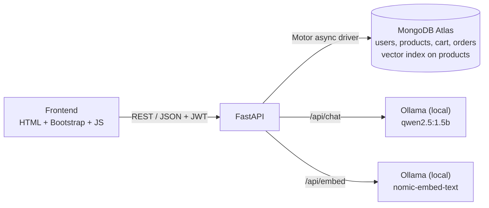
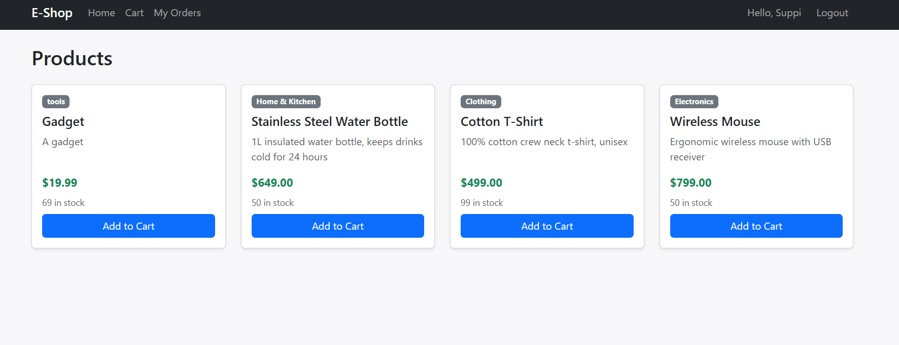
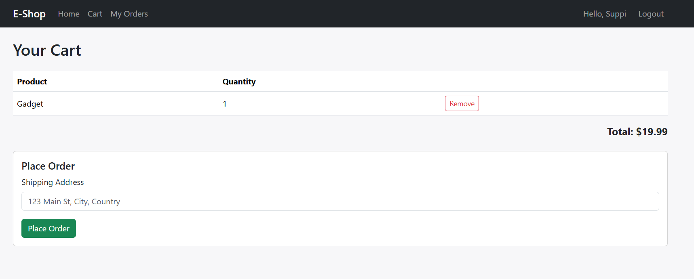
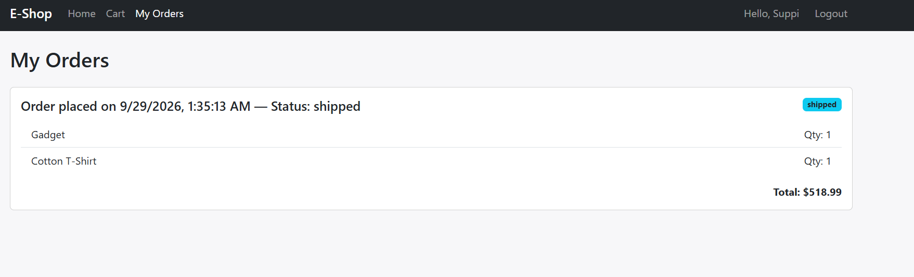
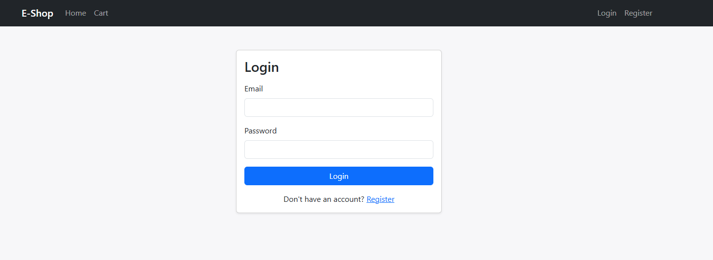
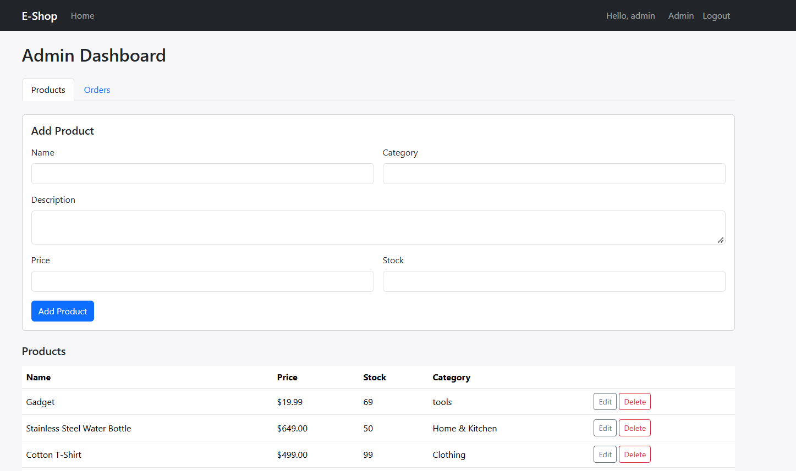
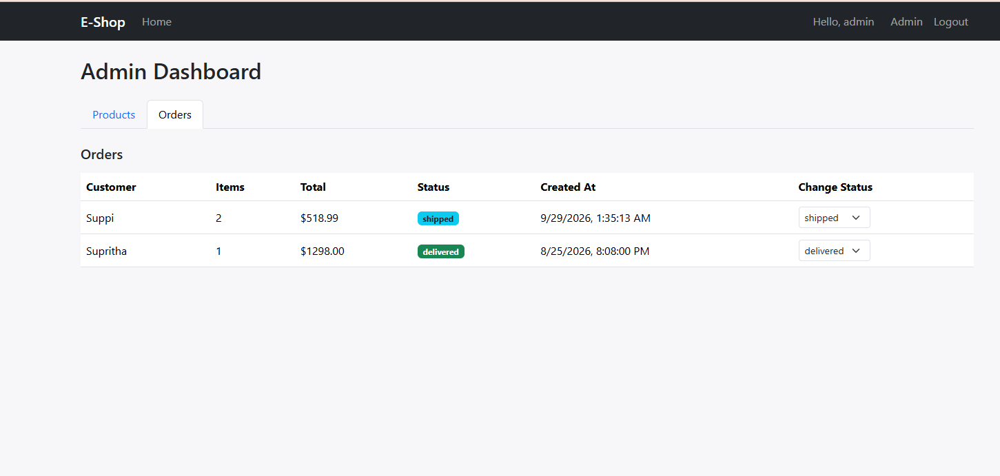

[](https://github.com/knsupritha-kn/-ecommerce-order-api-python/actions/workflows/ci.yml)

# E-commerce Order Management System

A full-stack e-commerce app built on **FastAPI + MongoDB Atlas**: a complete shopping flow (catalog, cart, orders) with an admin dashboard, plus an **AI layer** (Google Gemini in the cloud, or local Ollama) that adds semantic product search (RAG), an order-support assistant, and AI-drafted product descriptions. The AI layer degrades gracefully: if the AI provider isn't reachable, AI endpoints return `503` and the rest of the app works normally.

🔗 **Live Demo:** https://ecommerce-order-api-8u4j.onrender.com/login.html
> ⏳ Hosted on Render's free tier, so the first load may take ~50 seconds.
> 🤖 AI features work on the live demo using Google Gemini (free tier). Locally, the app can use Ollama instead (`LLM_PROVIDER=ollama`).

## Features

### Shop
- User registration and login (JWT, bcrypt-hashed passwords)
- Product browsing, cart, and order placement
- Order history with status tracking
- Admin dashboard: manage products, update order status
- Role-based access (user / admin)
- Race-safe checkout: stock is reserved with an atomic conditional update (`stock >= qty`), with rollback if any line fails, so concurrent orders can't oversell
- Pagination (`skip` / `limit`) on product and order lists

### AI (local Ollama, optional)
- **Semantic product search**: natural-language queries ("something for running") ranked by embedding similarity
- **Order assistant**: logged-in users ask questions about their own orders; the server fetches the data and the LLM only answers from it
- **AI product descriptions**: admins generate a draft description from name/category/keywords, then edit before saving
- **`/ai/health`**: reports whether Ollama and both models are available

### Engineering
- Automated tests (pytest, in-memory MongoDB mock, mocked Ollama) and ruff linting, run in GitHub Actions CI
- Request logging middleware (method, path, status, duration; no query strings, tokens or passwords)
- In-memory per-user rate limiting on AI endpoints (10 req/min, `429` + `Retry-After`)
- Dockerized

## Tech Stack
| Layer | Technology |
|---|---|
| Backend | Python 3.12, FastAPI, Pydantic, Motor (async MongoDB driver) |
| Auth | JWT (python-jose), bcrypt |
| Database | MongoDB Atlas (Atlas Vector Search for AI search) |
| AI | Ollama: `qwen2.5:1.5b` (chat), `nomic-embed-text` (768-dim embeddings), called with httpx |
| Frontend | HTML, Bootstrap 5, vanilla JavaScript |
| Testing / CI | pytest, pytest-asyncio, mongomock-motor, ruff, GitHub Actions |
| Deployment | Docker, Render |

## Architecture



Key design choices:
- **The server, not the LLM, decides what data the model sees.** The order assistant fetches only the logged-in user's orders in code and puts them in the prompt; a foreign order id is treated the same as a nonexistent one, so nothing leaks.
- **AI is optional.** All Ollama calls go through `app/ai/llm.py`, which raises one `AIUnavailableError` that routes map to `503`. Product create/update still succeed if embedding fails.

## How the semantic search (RAG) works

1. **Index time:** when an admin creates or updates a product, the app embeds `"name + description + category"` with `nomic-embed-text` and stores the 768-dim vector on the product document as `embedding`. `POST /ai/products/reindex` backfills existing products.
2. **Query time:** `GET /products/search?q=...` embeds the query with the same model.
3. **Retrieval:** the app runs an Atlas `$vectorSearch` on the `product_vector_index` index (cosine similarity) and returns the top `limit` products.
4. **Fallback:** if `$vectorSearch` fails (no index, non-Atlas MongoDB, or the mongomock database used in tests), it loads products that have embeddings and ranks them by **cosine similarity in Python**. Fine for small catalogs; Atlas handles scale.
5. The `embedding` field is never returned in API responses.

The Atlas index definition (database `ecommerce`, collection `products`, index name `product_vector_index`):

```json
{
  "fields": [
    {
      "type": "vector",
      "path": "embedding",
      "numDimensions": 768,
      "similarity": "cosine"
    }
  ]
}
```

## API Endpoints

Interactive docs are available at `/docs` (Swagger UI) when the server is running.

| Method | Path | Auth | Description |
|---|---|---|---|
| POST | `/auth/register` | none | Register a user |
| POST | `/auth/login` | none | Log in, returns JWT |
| GET | `/auth/me` | user | Current user |
| GET | `/users` | admin | List users |
| GET | `/products` | none | List products (`category`, `search`, `skip`, `limit`) |
| GET | `/products/search` | none | Semantic search (`q`, `limit`); `503` if AI is down |
| GET | `/products/{id}` | none | Get a product |
| POST | `/products` | admin | Create a product (also embeds it) |
| PUT | `/products/{id}` | admin | Update a product (re-embeds it) |
| DELETE | `/products/{id}` | admin | Delete a product |
| GET | `/cart` | user | View cart |
| POST | `/cart` | user | Add an item |
| PUT | `/cart/{product_id}` | user | Update item quantity |
| DELETE | `/cart/{product_id}` | user | Remove an item |
| DELETE | `/cart` | user | Clear cart |
| POST | `/orders` | user | Place an order from the cart |
| GET | `/orders` | user | Own orders (`skip`, `limit`) |
| GET | `/orders/{id}` | user | Get one of your orders |
| GET | `/orders/admin/all` | admin | All orders (`skip`, `limit`) |
| PUT | `/orders/{id}/status` | admin | Update order status |
| GET | `/ai/health` | none | Ollama and model availability |
| POST | `/ai/chat` | user | Ask about your orders (`{"message"}`, max 500 chars) |
| POST | `/ai/products/describe` | admin | Draft a product description |
| POST | `/ai/products/reindex` | admin | Generate embeddings for all products |
| GET | `/health` | none | Liveness check |

List endpoints return a plain JSON array. `skip` defaults to 0; `limit` defaults to 20 (max 100). `/ai/chat`, `/ai/products/describe` and `/ai/products/reindex` share a limit of 10 requests per minute per user.

## Run Locally

**Prerequisites:** Python 3.12, a MongoDB connection string (a free [MongoDB Atlas](https://www.mongodb.com/atlas) cluster works), and optionally [Ollama](https://ollama.com) for the AI features.

```bash
# 1. Create and activate a virtual environment
python -m venv venv
source venv/bin/activate        # Windows: venv\Scripts\activate

# 2. Install dependencies
pip install -r requirements.txt

# 3. Configure environment
cp .env.example .env            # then edit .env (see below)

# 4. (Optional) AI features: install Ollama, then pull the models
ollama pull qwen2.5:1.5b
ollama pull nomic-embed-text

# 5. Start the server
uvicorn app.main:app --reload
```

Open http://localhost:8000. Check AI status at http://localhost:8000/ai/health.

`.env` settings:

| Variable | Required | Default | Notes |
|---|---|---|---|
| `MONGO_URI` | yes | | MongoDB connection string |
| `SECRET_KEY` | yes | | Long random string for signing JWTs |
| `ALGORITHM` | no | `HS256` | JWT algorithm |
| `OLLAMA_BASE_URL` | no | `http://localhost:11434` | Ollama server |
| `LLM_MODEL` | no | `qwen2.5:1.5b` | Chat model |
| `EMBED_MODEL` | no | `nomic-embed-text` | Embedding model (768 dims) |
| `LOG_LEVEL` | no | `INFO` | Python log level |

To enable semantic search: create the Atlas vector index above, then log in as an admin and call `POST /ai/products/reindex` (Swagger UI at `/docs` is the easiest way). New and updated products are embedded automatically.

Promote a user to admin by setting `role: "admin"` on their document in the `users` collection (there is no public endpoint for this).

## Run Tests

```bash
pip install -r requirements-dev.txt
pytest
ruff check .
```

Tests use an in-memory MongoDB mock and mocked Ollama calls, so they need no database, network or Ollama. The same two commands run in GitHub Actions on every push and pull request.

## Docker

```bash
docker build -t ecommerce-order-api .
docker run --env-file .env -p 8000:8000 ecommerce-order-api
# or: docker compose up --build
```

`localhost` inside a container is the container itself, so to reach Ollama running on your host set `OLLAMA_BASE_URL=http://host.docker.internal:11434` in `.env`.

## Screenshots

### User
| Home | Cart |
|---|---|
|  |  |
| **My Orders** | **Login** |
|  |  |

### Admin
| Products | Orders |
|---|---|
|  |  |
